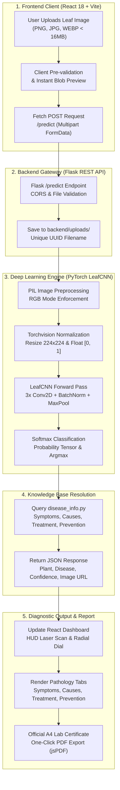
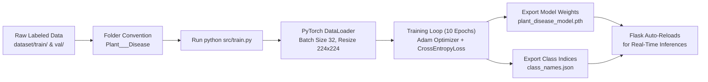

<div align="center">
  <h1>🌿 BioShield AI - Plant Disease Detection System</h1>
  <p>
    <strong>A modern full-stack deep learning application for detecting plant diseases using image recognition and machine learning.</strong>
  </p>
  <p>
    
    
    
    
    
  </p>
</div>

<br />

## 🌟 Overview

**BioShield AI** is an end-to-end plant pathology diagnostics system. It combines a **PyTorch Convolutional Neural Network (CNN)** backend running on **Flask** with a high-performance **React + Vite** single-page frontend.

Users can upload photos of plant leaves or select sample crops to receive:
- **Instant Disease Classification** (with confidence percentage)
- **Holographic Scanner Visualization** with dynamic laser targeting
- **Detailed Pathology & Care Recommendations** (Symptoms, Causes, Prevention, and Treatment)
- **Official Laboratory PDF Diagnostic Report** (with certificate double borders & one-click download)

---

## 🔄 End-to-End System Workflow



---

## 🧭 Step-by-Step User Journey

```
   [ 1. Input Specimen ]          [ 2. Neural Scan ]             [ 3. Clinical Findings ]        [ 4. Actionable Report ]
  ┌─────────────────────┐       ┌─────────────────────┐        ┌─────────────────────────┐     ┌────────────────────────┐
  │ • Drag & drop photo │       │ • Rescaling to 224² │        │ • Detected Condition    │     │ • Official Certificate │
  │ • Or pick sample    │ ───►  │ • 3-Block Conv2D    │ ────►  │ • Match Probability %   │ ──► │ • Double border frame  │
  │ • Instant thumbnail │       │ • Softmax Inference │        │ • Severity Stamp (Risk) │     │ • Direct PDF Download  │
  └─────────────────────┘       └─────────────────────┘        │ • Symptoms & Treatment  │     └────────────────────────┘
                                                               └─────────────────────────┘
```

1. **Specimen Input**: Drag and drop a photograph of an affected leaf, or select any pre-loaded crop sample (Tomato, Apple, Corn, Potato).
2. **Inference & Feature Extraction**: The leaf matrix is passed through three sequential convolutional blocks with batch normalization to extract lesion geometry, discoloration, and textural patterns.
3. **Pathology Resolution**: The classified disease is cross-referenced with the internal agronomic database to determine whether it is fungal, bacterial, or normal foliage.
4. **Certificate & PDF Export**: The user can inspect the interactive report, copy the prescription summary, or click **"Download PDF Report"** to export an official bordered laboratory certificate.

---

## 🔁 Model Retraining & Extension Workflow

To train new plant species or update existing model weights:



1. **Prepare Dataset**: Organize labeled images into `backend/dataset/train/<Crop>___<Condition>` and `backend/dataset/validation/<Crop>___<Condition>`.
2. **Execute Training**:
   ```bash
   cd backend
   python src/train.py
   ```
3. **Automated Artifact Generation**: The pipeline trains the CNN, reports validation accuracy per epoch, updates `class_names.json`, and serializes the new weights to `plant_disease_model.pth`.
4. **Instant Serving**: The Flask backend immediately uses the updated weights on the next prediction request without needing code changes.

---

## 📁 Project Architecture

```
PLANT DISEASE DETECTION SYSTEM/
├── backend/
│   ├── dataset/                   # Training and validation dataset images
│   ├── src/
│   │   ├── disease_info.py        # Pathology knowledge base (10 classes)
│   │   ├── model_utils.py         # PyTorch CNN model architecture & preprocessing
│   │   └── train.py               # Dataset generator & model training pipeline
│   ├── uploads/                   # Temporary storage for analyzed leaf images
│   ├── app.py                     # Flask REST API endpoints (/predict, /predict_sample, /api/diseases)
│   ├── class_names.json           # Trained class labels mapping
│   ├── plant_disease_model.pth    # Pretrained PyTorch CNN model weights
│   └── requirements.txt           # Python dependencies (Flask, PyTorch, torchvision, CORS)
│
├── frontend/
│   ├── public/leaf.svg            # Botanical logo asset
│   ├── src/
│   │   ├── components/            # Grouped Feature Modules
│   │   │   ├── layout/            # Top Navigation, Hero Metrics & Footer
│   │   │   │   ├── Navbar.jsx
│   │   │   │   ├── HeroSection.jsx
│   │   │   │   └── Footer.jsx
│   │   │   ├── scanner/           # Foliage Diagnosis & Detection Hub
│   │   │   │   ├── UploadZone.jsx
│   │   │   │   ├── SampleGallery.jsx
│   │   │   │   └── DiagnosticHub.jsx
│   │   │   ├── report/            # A4 Certificate Bordered Report & PDF Modal
│   │   │   │   ├── OfficialPdfReport.jsx
│   │   │   │   └── ReportModal.jsx
│   │   │   ├── views/             # Pathology Encyclopedia & Model Explainer
│   │   │   │   ├── DiseaseEncyclopedia.jsx
│   │   │   │   └── ModelArchitecture.jsx
│   │   │   └── index.js           # Consolidated barrel exports
│   │   ├── routes/                # Centralized Client-Side Routing
│   │   │   ├── paths.js           # Route URL constants (HOME, ENCYCLOPEDIA, ARCHITECTURE)
│   │   │   ├── AppRoutes.jsx      # Declarative Route mappings & fallback redirect
│   │   │   ├── DiagnosticLabPage.jsx  # / page view (Scanner & Lab workspace)
│   │   │   ├── EncyclopediaPage.jsx   # /encyclopedia page view
│   │   │   ├── ArchitecturePage.jsx   # /architecture page view
│   │   │   └── index.js           # Routes barrel export
│   │   ├── utils/
│   │   │   └── pdfExport.js       # High-resolution PDF generation engine (jsPDF + html2canvas)
│   │   ├── App.jsx                # Root React application controller
│   │   ├── index.css              # Cyber-botanical design system & A4 borders
│   │   └── main.jsx               # React 18 DOM mount entry point
│   ├── index.html                 # HTML5 template with modern typography links
│   ├── package.json               # Node.js dependencies & build scripts
│   └── vite.config.js                 # Vite bundler configuration with API reverse proxy
│
├── .gitignore                         # Git exclusion rules
└── README.md                          # Full system documentation
```

---

## 📡 REST API Specifications

| Method | Endpoint | Description | Payload / Parameters | Response |
| :--- | :--- | :--- | :--- | :--- |
| `GET` | `/api/health` | Service status heartbeat | None | `{"status": "healthy", "service": "..."}` |
| `POST` | `/predict` | Upload leaf image for classification | `FormData: { file: <image> }` | `{"success": true, "plant_name": "...", "confidence": 98.4, ...}` |
| `GET` | `/predict_sample` | Run inference on pre-loaded validation sample | `?class_name=<Class_Name>` | `{"success": true, "plant_name": "...", "confidence": ..., ...}` |
| `GET` | `/api/diseases` | Retrieve full knowledge base | None | `{"success": true, "count": 10, "diseases": {...}}` |
| `GET` | `/uploads/<filename>` | Serve analyzed leaf scans | Path variable | Image file stream |

---

## 🚀 How to Run the Project

Running the project requires starting the **Backend** and the **Frontend** in two separate terminals.

### 1️⃣ Start the Backend (Flask API)

Open your first terminal:

```bash
# Navigate to the backend directory
cd backend

# Start the Flask API server
python app.py
```

> The backend server will start on: **`http://localhost:5000`**

---

### 2️⃣ Start the Frontend (React + Vite)

Open a second terminal:

```bash
# Navigate to the frontend directory
cd frontend

# Start the Vite development server
npm run dev
```

> The React frontend will start on: **`http://localhost:5173`**
>
> Open your browser and navigate to **`http://localhost:5173`** to use the application.

---

## 🌱 Supported Plant Diseases

- **Apple**: Black Rot, Healthy
- **Corn**: Common Rust, Healthy
- **Potato**: Early Blight, Late Blight, Healthy
- **Tomato**: Bacterial Spot, Early Blight, Healthy
